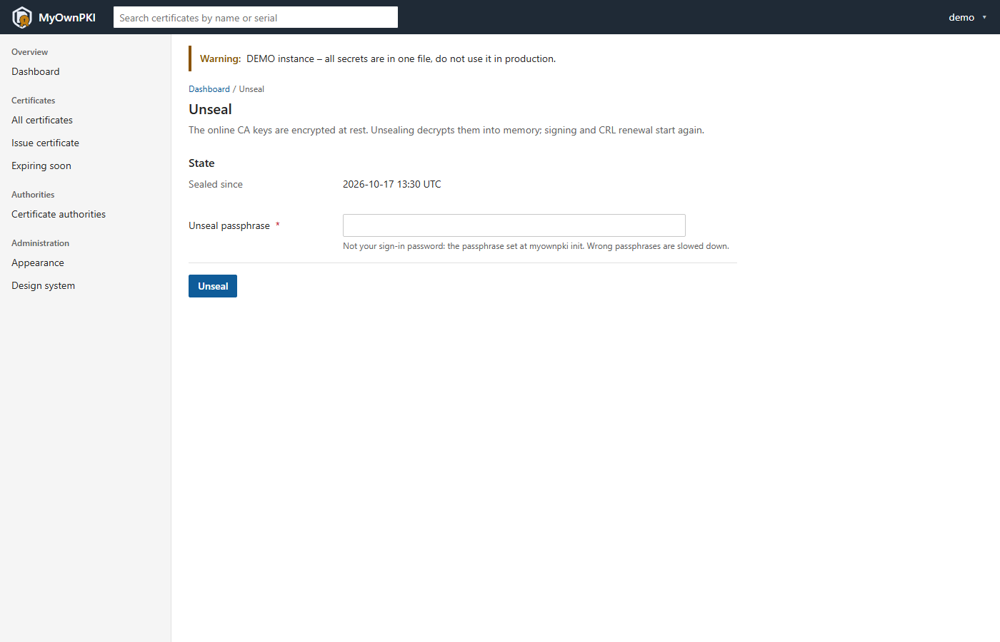
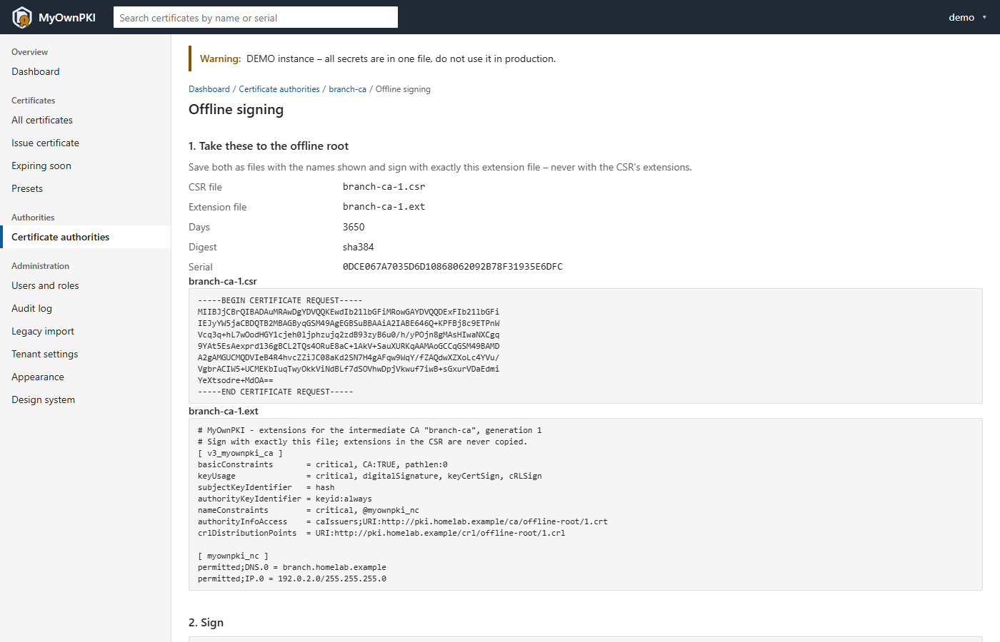
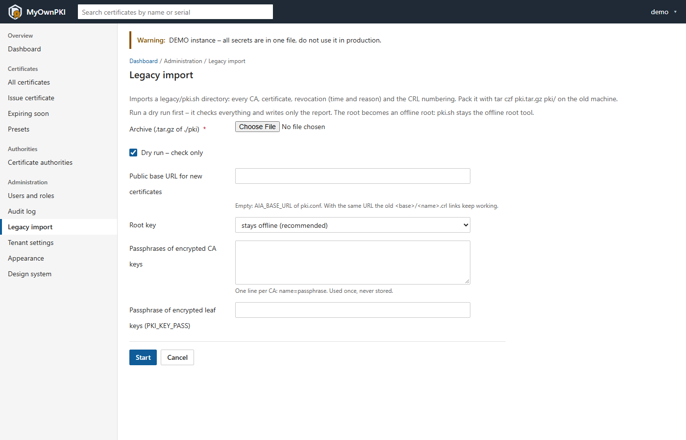
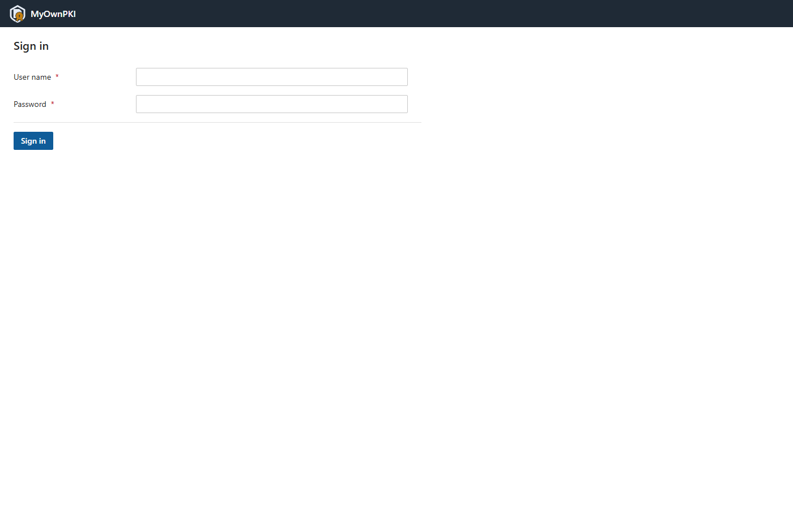
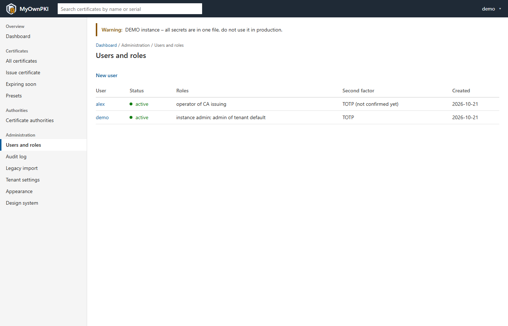
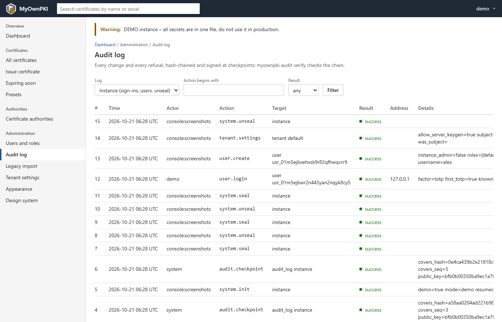
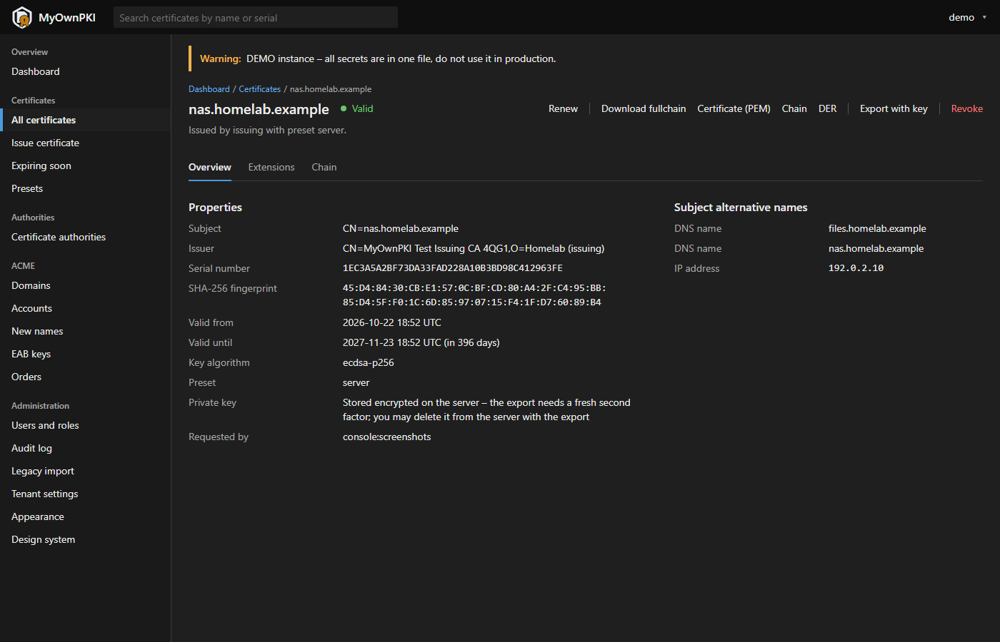

<picture>
  <source media="(prefers-color-scheme: dark)" srcset="assets/brand/logo-on-dark.svg">
  
</picture>

# MyOwnPKI

**Your own PKI – self-hosted, automated, from homelab to enterprise.**

> **Status: v0.1 – phase 1 complete.** A working CA with web UI, REST API, legacy import and
> backup – it replaces the `pki.sh` Bash suite. The ACME server follows in v0.2, the agent and
> monitoring in v0.3. See [docs/PLAN.md](docs/PLAN.md) for the architecture, decisions and roadmap.

MyOwnPKI is a self-hosted certificate authority platform. v0.1 brings the CA, the web UI and the
REST API, the import of a `pki.sh` PKI and backups; the rest of this list follows up to v1.0:

- **Secure web UI** with dashboards, upload/download and role-based access
- **ACME server** for your internal CA – use certbot, acme.sh, Traefik, Caddy or win-acme
- **ACME client** for public certificates from Let's Encrypt / ZeroSSL (http-01, dns-01)
- **Optional agent** that deploys certificates to Linux, Windows and FreeBSD hosts, reloads
  services safely and monitors what is actually being served
- **Multiple domains and tenants**, policies per domain, audit log
- **Runs anywhere** as a single binary or container: Docker, Podman, LXC, Linux, macOS, Windows, FreeBSD

> **Screenshots of v0.1** – a demo instance (`myownpki init --demo`) with sample certificates
> under homelab.example.

<p></p>

<table>
  <tr>
    <td width="33%"><a href="docs/screenshots/certificates.png"></a><br>Certificates</td>
    <td width="33%"><a href="docs/screenshots/certificate-detail.png"></a><br>Certificate detail</td>
    <td width="33%"><a href="docs/screenshots/issue-wizard.png"></a><br>Issue wizard</td>
  </tr>
  <tr>
    <td><a href="docs/screenshots/authorities.png"></a><br>Certificate authorities</td>
    <td><a href="docs/screenshots/dashboard-dark.png"></a><br>Dark theme</td>
    <td><a href="docs/screenshots/unseal.png"></a><br>Unseal</td>
  </tr>
  <tr>
    <td><a href="docs/screenshots/offline-signing.png"></a><br>Offline root signing</td>
    <td><a href="docs/screenshots/legacy-import.png"></a><br>Legacy import</td>
    <td><a href="docs/screenshots/login.png"></a><br>Sign in</td>
  </tr>
  <tr>
    <td><a href="docs/screenshots/users.png"></a><br>Users and roles</td>
    <td><a href="docs/screenshots/audit-log.png"></a><br>Audit log</td>
    <td><a href="docs/screenshots/certificate-detail-dark.png"></a><br>Detail, dark theme</td>
  </tr>
</table>

## Install

Read [docs/OPERATIONS.md](docs/OPERATIONS.md) first – above all the warning about the unseal
passphrase. Releases: <https://github.com/Der-Felix/MyOwnPKI/releases>.

### From a release archive

Archives for linux/amd64, linux/arm64, darwin/arm64, windows/amd64 and freebsd/amd64 hold the
single `myownpki` binary, the operations guide and an example configuration.

```sh
v=0.1.0
curl -fsSLO "https://github.com/Der-Felix/MyOwnPKI/releases/download/v$v/myownpki_${v}_linux_amd64.tar.gz"
curl -fsSLO "https://github.com/Der-Felix/MyOwnPKI/releases/download/v$v/checksums.txt"
curl -fsSLO "https://github.com/Der-Felix/MyOwnPKI/releases/download/v$v/checksums.txt.sigstore.json"
```

Then verify the download (next section), unpack it, copy `deploy/config.example.yaml` to
`/etc/myownpki/config.yaml` and continue with `myownpki init` (docs/OPERATIONS.md §3).

### With Docker

The image `ghcr.io/der-felix/myownpki` (linux/amd64 and linux/arm64) is distroless and runs as a
non-root user; the data directory is a volume, and the image's healthcheck runs
`myownpki healthcheck`. For a single server, use [`deploy/docker-compose.yml`](deploy/docker-compose.yml)
with [`deploy/docker/config.yaml`](deploy/docker/config.yaml):

```sh
docker compose run --rm -it myownpki init
docker compose up -d
```

### Verify a download

Every release is built by [`.github/workflows/release.yml`](.github/workflows/release.yml) and
signed keyless with [cosign](https://github.com/sigstore/cosign) (Sigstore): the signature proves
that the files come from that workflow at that tag – there is no key to steal. First the checksum
file, then the archive against it:

```sh
cosign verify-blob \
  --bundle checksums.txt.sigstore.json \
  --certificate-identity "https://github.com/Der-Felix/MyOwnPKI/.github/workflows/release.yml@refs/tags/v$v" \
  --certificate-oidc-issuer https://token.actions.githubusercontent.com \
  checksums.txt
sha256sum --check --ignore-missing checksums.txt
```

The image:

```sh
cosign verify ghcr.io/der-felix/myownpki:0.1.0 \
  --certificate-identity "https://github.com/Der-Felix/MyOwnPKI/.github/workflows/release.yml@refs/tags/v0.1.0" \
  --certificate-oidc-issuer https://token.actions.githubusercontent.com
```

Each archive has an SPDX SBOM next to it (`*.sbom.json`, listed in `checksums.txt`). The builds
are reproducible: the same tag built again gives byte-identical archives.

## Repository layout

| Path | Content |
|---|---|
| `docs/PLAN.md` | Project plan, architecture decisions (ADRs), roadmap |
| `docs/OPERATIONS.md` | Operations guide: install, init, backup and restore, emergencies |
| `docs/RELEASING.md` | How a release is made (owner checklist) |
| `deploy/` | Example configuration, Dockerfile and Docker Compose file |
| `CHANGELOG.md` | Changes per release |
| `cmd/` | The three binaries: `myownpki` (server), `myownpki-agent`, `myownpki-ctl` |
| `internal/ca/preset` | Loader and validation for certificate presets |
| `internal/web` | templ components, layouts and pages of the admin UI |
| `presets/` | Built-in certificate presets (YAML, ported from `legacy/lib/presets.sh`) |
| `api/openapi.yaml` | REST API specification (OpenAPI 3.1) |
| `web/styles/` | Design tokens and the global CSS classes |
| `legacy/` | The original Bash PKI suite (`pki.sh`) – still usable as an offline/air-gapped root CA tool |

## Development

Requirements: Go (the exact toolchain is pinned in `go.mod` and downloaded automatically),
[Task](https://taskfile.dev), [golangci-lint](https://golangci-lint.run) and [sqlc](https://sqlc.dev) – versions in `Taskfile.yml`.
templ and govulncheck are pinned in `go.mod` and run via `go tool`. Works in PowerShell and Git Bash.
Rules for changes and commits: [CONTRIBUTING.md](CONTRIBUTING.md).

```sh
task              # list all tasks
task check        # everything that must pass before a commit
task dev          # UI prototype at http://127.0.0.1:9443/ (no TLS, no login, loopback only)
task screenshots  # regenerate docs/screenshots – at milestones only
task vuln         # known vulnerabilities in dependencies and the Go standard library
task lint:ci      # actionlint on the GitHub workflows (needs actionlint, see Taskfile.yml)
task lint:api     # vacuum on api/openapi.yaml (needs vacuum, see Taskfile.yml)
task cross        # build for linux/amd64, linux/arm64, darwin/arm64, windows/amd64, freebsd/amd64
task release:check     # check .goreleaser.yaml (needs goreleaser, see Taskfile.yml)
task release:snapshot  # local release build into dist/ – no signing, no image, nothing published
```

## Legacy Bash suite

The predecessor of this project lives in [`legacy/`](legacy/README.md). It remains supported as an
offline tool for root CA ceremonies. Its full history is in the original
[pki_script](https://github.com/Der-Felix/pki_script) repository.

## Security

Please report vulnerabilities privately – see [SECURITY.md](SECURITY.md).

## License

[Apache License 2.0](LICENSE)
