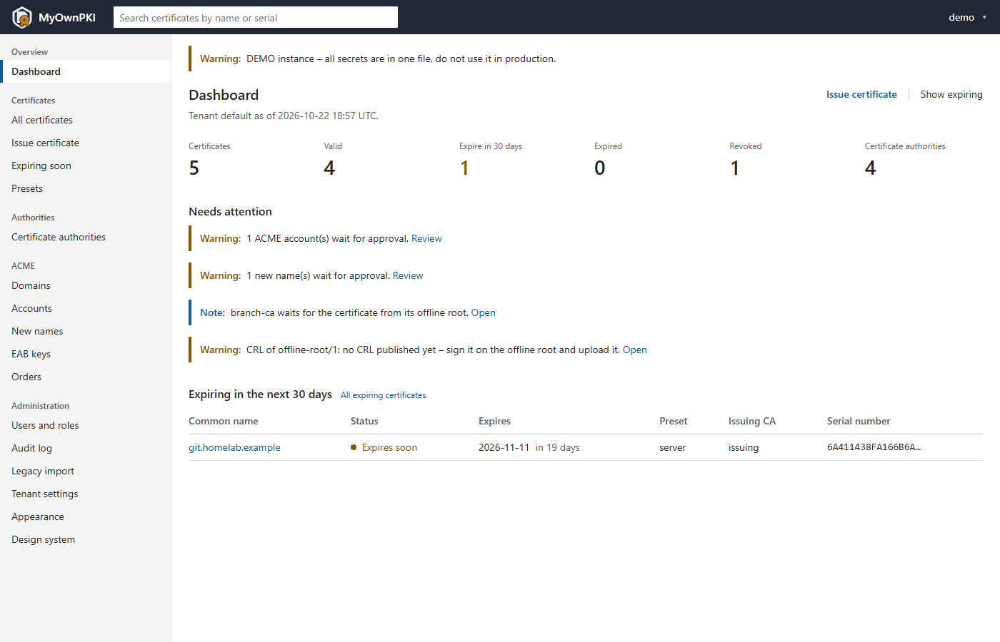
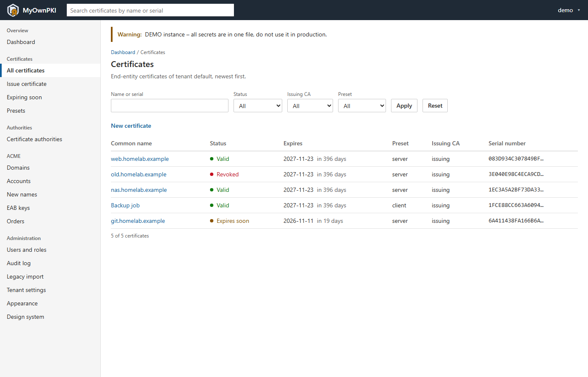
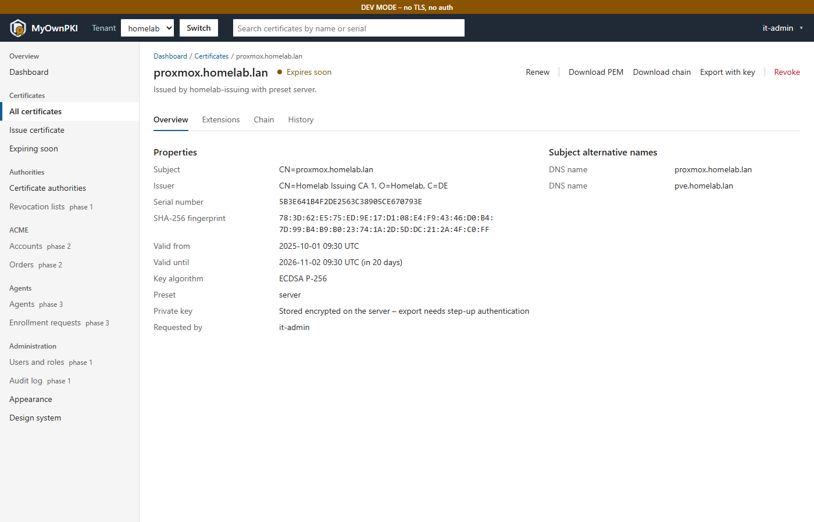
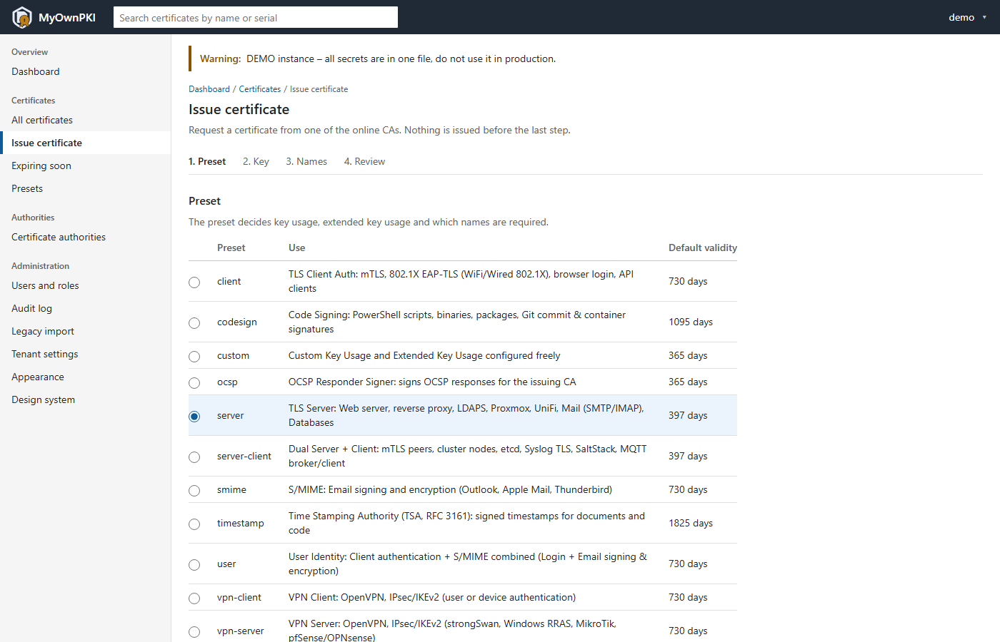
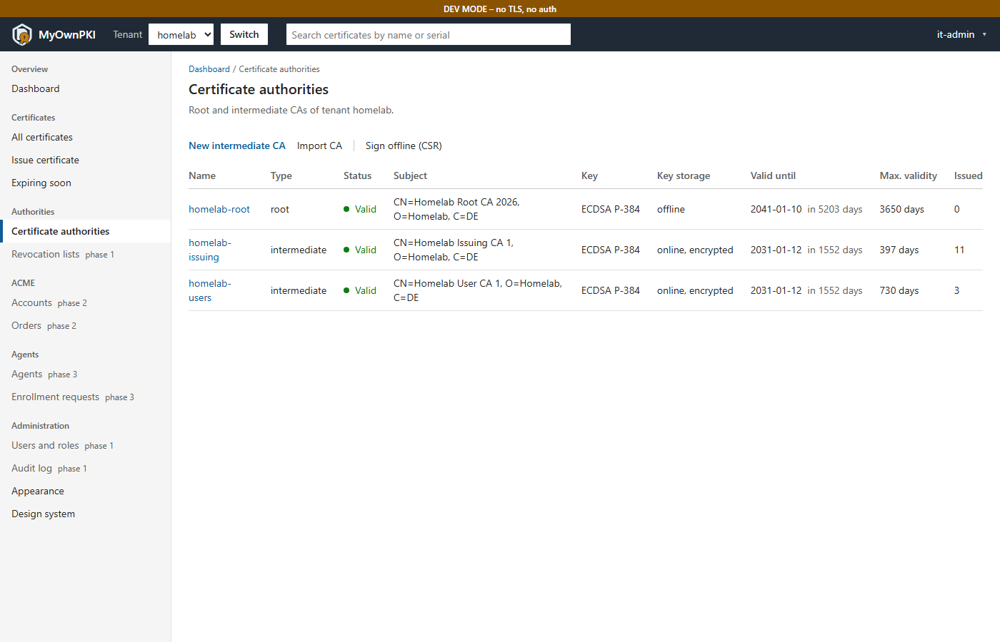
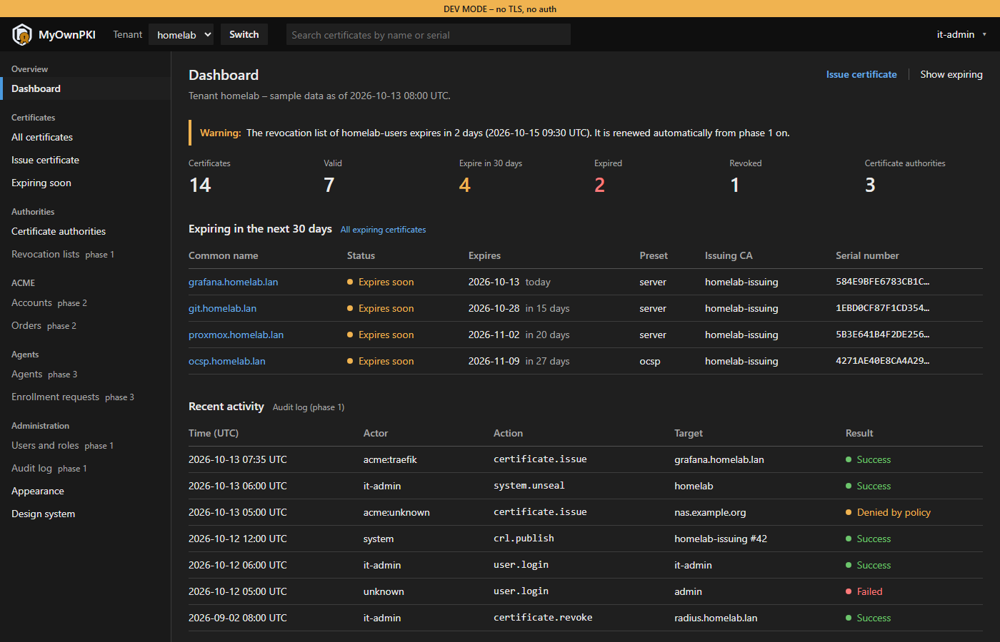

<picture>
  <source media="(prefers-color-scheme: dark)" srcset="assets/brand/logo-on-dark.svg">
  
</picture>

# MyOwnPKI

**Your own PKI – self-hosted, automated, from homelab to enterprise.**

> **Status: phase 1 in progress.** Phase 0 (foundation) is complete and the UI prototype runs on
> sample data, but there is no CA functionality yet. See [docs/PLAN.md](docs/PLAN.md) for the
> architecture, decisions and roadmap.

MyOwnPKI is a self-hosted certificate authority platform:

- **Secure web UI** with dashboards, upload/download and role-based access
- **ACME server** for your internal CA – use certbot, acme.sh, Traefik, Caddy or win-acme
- **ACME client** for public certificates from Let's Encrypt / ZeroSSL (http-01, dns-01)
- **Optional agent** that deploys certificates to Linux, Windows and FreeBSD hosts, reloads
  services safely and monitors what is actually being served
- **Multiple domains and tenants**, policies per domain, audit log
- **Runs anywhere** as a single binary or container: Docker, Podman, LXC, Linux, macOS, Windows, FreeBSD

> **UI prototype with sample data – phase 1 in progress.**

<p></p>

<table>
  <tr>
    <td width="33%"><a href="docs/screenshots/certificates.png"></a><br>Certificates</td>
    <td width="33%"><a href="docs/screenshots/certificate-detail.png"></a><br>Certificate detail</td>
    <td width="33%"><a href="docs/screenshots/issue-wizard.png"></a><br>Issue wizard</td>
  </tr>
  <tr>
    <td><a href="docs/screenshots/authorities.png"></a><br>Certificate authorities</td>
    <td><a href="docs/screenshots/dashboard-dark.png"></a><br>Dark theme</td>
    <td></td>
  </tr>
</table>

## Repository layout

| Path | Content |
|---|---|
| `docs/PLAN.md` | Project plan, architecture decisions (ADRs), roadmap |
| `cmd/` | The three binaries: `myownpki` (server), `myownpki-agent`, `myownpki-ctl` |
| `internal/ca/preset` | Loader and validation for certificate presets |
| `internal/web` | templ components, layouts and pages of the admin UI |
| `presets/` | Built-in certificate presets (YAML, ported from `legacy/lib/presets.sh`) |
| `api/openapi.yaml` | REST API specification (draft for phase 1) |
| `web/styles/` | Design tokens and the global CSS classes |
| `legacy/` | The original Bash PKI suite (`pki.sh`) – still usable as an offline/air-gapped root CA tool |

## Development

Requirements: Go (the exact toolchain is pinned in `go.mod` and downloaded automatically),
[Task](https://taskfile.dev) and [golangci-lint](https://golangci-lint.run) – versions in `Taskfile.yml`.
templ and govulncheck are pinned in `go.mod` and run via `go tool`. Works in PowerShell and Git Bash.
Rules for changes and commits: [CONTRIBUTING.md](CONTRIBUTING.md).

```sh
task              # list all tasks
task check        # everything that must pass before a commit
task dev          # UI prototype at http://127.0.0.1:9443/ (no TLS, no login, loopback only)
task screenshots  # regenerate docs/screenshots – at milestones only
task vuln         # known vulnerabilities in dependencies and the Go standard library
task lint:ci      # actionlint on the GitHub workflows (needs actionlint, see Taskfile.yml)
task lint:api     # vacuum on api/openapi.yaml (needs vacuum, see Taskfile.yml)
task cross        # build for linux/amd64, linux/arm64, darwin/arm64, windows/amd64, freebsd/amd64
```

## Legacy Bash suite

The predecessor of this project lives in [`legacy/`](legacy/README.md). It remains supported as an
offline tool for root CA ceremonies. Its full history is in the original
[pki_script](https://github.com/Der-Felix/pki_script) repository.

## Security

Please report vulnerabilities privately – see [SECURITY.md](SECURITY.md).

## License

[Apache License 2.0](LICENSE)
